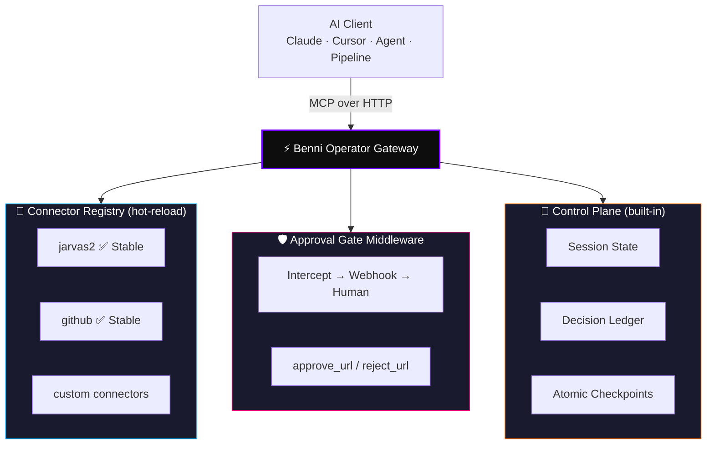

<div align="center">


<br/>


<br/><br/>

[](LICENSE)
[](https://www.typescriptlang.org/)
[](https://nodejs.org/)
[](https://modelcontextprotocol.io/)
[](CONTRIBUTING.md)
[](https://github.com/benni-os)

<br/>

> **"You need a gate, not a rubber stamp."**


<br/>



<br/>

</div>

<br/>

## ⭐ What Is Benni Operator Gateway?

**Benni Operator Gateway** is the open-source MCP infrastructure layer of the **[Benni OS](https://github.com/benni-os)** ecosystem — a production-grade HTTP gateway implementing the [Model Context Protocol](https://modelcontextprotocol.io/), purpose-built for autonomous AI operators.

It gives any MCP-compatible client (Claude Desktop, Cursor, custom agents, CI pipelines) a single, secure, extensible interface to interact with your tools, services, and data — without surrendering control to third-party managed APIs.

```
INTENTION → AI CLIENT → MCP OVER HTTP → OPERATOR GATEWAY → APPROVAL GATE → EXECUTION → AUDIT LOG
```

<br/>


## ⚡ Core Doctrine

> These are not settings. These are architecture laws.

| ☔ Principle | 🔧 Implementation |
|---|---|
| **Gate, Not Rubber Stamp** | Every sensitive action is intercepted — agent pauses, human approves, then execution resumes |
| **Hot-Reload Registry** | Add or remove connectors live — zero downtime, zero redeploy |
| **Decision Ledger** | Every tool dispatch logged with full context — tamper-evident, append-only |
| **Provider-Agnostic** | Route any LLM behind one interface — no lock-in, no vendor dependency |
| **Session Continuity** | Built-in Control Plane persists state and atomic checkpoints across agent runs |
| **Open Core** | Gateway is, and will remain, fully MIT — build on it, fork it, contribute back |

<br/>


## 🏗️ Architecture



<br/>


## 🚀 Quick Start

```bash
# 1. Clone
git clone https://github.com/benni-os/benni-operator-gateway
cd benni-operator-gateway

# 2. Install
npm install

# 3. Configure
cp .env.example .env
# Edit .env — set GATEWAY_API_KEY, APPROVAL_WEBHOOK_URL, GITHUB_TOKEN

# 4. Run (development)
npm run dev

# 4b. Run (production)
npm run build && npm start
```

Your MCP gateway is live at `http://localhost:3000`.
Point any MCP-compatible client to `http://localhost:3000/mcp`.

<br/>


## 🔌 Built-in Connectors

| Connector | Status | Description |
|---|---|---|
| `jarvas2` | ✅ Stable | JARVAS-2 agent runtime — dispatch tasks, queue jobs, set objectives, read operational memory |
| `github` | ✅ Stable | Full GitHub API surface — issues, PRs, code search, reviews, branch management, secret scanning |
| `control-plane` | 🔧 Beta | Gateway-native session state, atomic checkpoints, decision ledger — no external dependency |

> The gateway is fully functional as a standalone MCP gateway. JARVAS-2 and Benni Control Plane are optional — connect any agent backend or build your own connector.

<br/>


## 🛡️ Approval Gate

The built-in **human-in-the-loop middleware** intercepts any tool call marked `requires_approval: true`. The agent pauses, your webhook fires, nothing executes until you approve or reject.

```typescript
// Payload sent to APPROVAL_WEBHOOK_URL
{
  "action": "deploy_to_production",
  "reason": "Agent requested deployment after build passed",
  "payload": { ... },
  "approve_url": "https://your-gateway/approve/req_abc123",
  "reject_url":  "https://your-gateway/reject/req_abc123"
}
```

**Pause → Notify → Resume.** The core safety primitive for running agents against real infrastructure.

<br/>


## ⚙️ Configuration

```bash
# Server
PORT=3000
NODE_ENV=production

# Auth
GATEWAY_API_KEY=your_secret_key

# Approval Gate
APPROVAL_WEBHOOK_URL=https://your-endpoint/approval
APPROVAL_TIMEOUT_MS=300000  # 5 minutes

# Project Benjamin Connector (optional)
BENJAMIN_API_URL=https://your-benjamin-instance
BENJAMIN_API_KEY=your_benjamin_key
# Legacy fallback:
JARVAS2_API_URL=https://your-benjamin-instance
JARVAS2_API_KEY=your_benjamin_key

# GitHub Connector
GITHUB_TOKEN=your_github_pat
```

<br/>


## 📁 Project Structure

```
src/
├── app.ts               # Server bootstrap
├── index.ts             # Entrypoint
├── config/              # Environment & provider config
├── connectors/          # MCP connector modules
│   ├── jarvas2/         # JARVAS-2 connector
│   └── github/          # GitHub MCP connector
├── middleware/          # Auth, approval gate, rate limiting
├── registry/            # Hot-reload connector registry
├── routes/              # HTTP endpoints
├── services/            # LLM dispatch, session management
└── types/               # TypeScript contracts
```

<br/>


## 🚢 Deployment

```bash
# Docker
docker build -t benni-operator-gateway .
docker run -p 3000:3000 --env-file .env benni-operator-gateway

# Fly.io (fly.toml included)
fly deploy

# Any VPS / cloud VM
npm run build && npm start
```

<br/>


## 🗺️ Roadmap

- [x] MCP HTTP gateway core
- [x] Project Benjamin connector
- [x] GitHub connector
- [x] Human approval gate
- [x] Built-in Control Plane (session state, ledger, checkpoints)
- [ ] npm package `@benni-os/operator-gateway`
- [ ] Docker image + one-click Railway / Render deploy
- [ ] Web dashboard (runs · decisions · health)
- [ ] Plugin SDK for custom connector development
- [ ] OpenTelemetry tracing integration
- [ ] Multi-tenant workspace isolation

<br/>


## 🤝 Contributing

Contributions welcome — especially new connectors. See [CONTRIBUTING.md](CONTRIBUTING.md).

Highest-value contributions right now:
- New MCP connectors (Notion, Linear, Slack, Supabase, etc.)
- Improved approval gate delivery (email, Telegram, SMS)
- Docker Compose + one-click deploy configurations
- Observability integrations (OpenTelemetry, Grafana)

<br/>


## 🌐 The Benni OS Ecosystem

`benni-operator-gateway` is part of the **Benni OS** decentralized agentic architecture. The ecosystem is organized into modular **Public Open-Source Infrastructure** and **Proprietary Core Autonomous Systems**:

### 🔓 Public Open-Source Infrastructure

| Layer / Domain | Repository | Maintainer | Description | Status |
|---|---|---|---|---|
| **Security & Defense** | [**`agent-cyber-sentinel`**](https://github.com/BenniAlencar/agent-cyber-sentinel) | `@BenniAlencar` | Tier-0 Zero-Trust runtime security shield, prompt injection firewall & secret redactor. | 🟢 Stable (Apache-2.0) |
| **Execution & State** | [**`agent-run-ledger`**](https://github.com/BenniAlencar/agent-run-ledger) | `@BenniAlencar` | Resumable multi-step execution state machine, anti-loop circuit breaker & crash recovery. | 🟢 Stable (Apache-2.0) |
| **Long-Term Memory** | [**`agent-memory-mesh`**](https://github.com/BenniAlencar/agent-memory-mesh) | `@BenniAlencar` | Sovereign bi-temporal knowledge graph & episodic memory with multi-tenant isolation. | 🟢 Stable (Apache-2.0) |
| **Zero-Trust Verification** | [**`reality-lock`**](https://github.com/BenniAlencar/reality-lock) | `@BenniAlencar` | Cryptographic execution verification & signed SHA-256 evidence ledgers for side-effects. | 🟢 Stable (Apache-2.0) |
| **MCP Tooling Matrix** | [**`mcp-forge`**](https://github.com/benni-os/mcp-forge) | `Benni-OS` | Rapid developer toolchain for building, validating, and publishing Model Context Protocol servers. | 🟢 Public OSS |
| **Local Hybrid Inference** | [**`benni-inference-engine`**](https://github.com/benni-os/benni-inference-engine) | `Benni-OS` | GPU+CPU MoE expert offloading runtime with Skill 81 Ceiling Extraction on consumer hardware. | 🟢 Public OSS |
| **Federated Execution** | [**`benni-operator-gateway`**](https://github.com/benni-os/benni-operator-gateway) | `Benni-OS` | Unified policy-governed operator gateway for dispatching actions across local and cloud environments. | 🟢 Public OSS |
| **Model Routing Hub** | [**`benni-nexus`**](https://github.com/benni-os/benni-nexus) | `Benni-OS` | Intelligent LLM model router optimizing for latency, cost, and task-specific reasoning ceilings. | 🟢 Public OSS |
| **Autonomous Community** | [**`community-autopilot`**](https://github.com/benni-os/community-autopilot) | `Benni-OS` | Autonomous event-driven community management, issue triage, and repository telemetry. | 🟢 Public OSS |

---

### 🔒 Proprietary Core & Autonomous Systems (Enterprise Benni OS)

The open-source stack serves as the decentralized foundation for the enterprise-grade Benni OS autonomous swarm kernel:

| System | Role & Scope | Architecture Doctrine | Access |
|---|---|---|---|
| **Benni Master OS** | Central operating system kernel v9.4 governing 43 canonical skills, runtime contracts, and swarm coordination. | `Universal Skills 00–100` | 🔒 Private Core |
| **Project Benjamin** | Sovereign autonomous execution orchestrator with typed handoff contracts and zero-human-in-the-loop loops. | `Skill 93 Autonomous Dispatch` | 🔒 Private Core |
| **Project Adam** | Agent synthesis, benchmark evaluation, and continuous recursive self-evolution engine. | `Skill 92 Self-Evolution` | 🔒 Private Core |
| **Benni Control Plane** | Distributed state persistence, atomic snapshot restore protocols, and multi-tenant ledger governance. | `Skill 90 Control Plane OS` | 🔒 Enterprise |
| **Benni Social Hub** | Multi-channel content authority distribution, attribution engine, and automated revenue funnels. | `Skill 52 & Skill 95 Revenue Loop` | 🔒 Enterprise |
| **Benni Canvas** | Autonomous UI engineering subsystem v14.0 delivering generative high-end motion and responsive dashboards. | `Skill 54 Open Design & Skill 56` | 🔒 Enterprise |
| **Benni Nemesis** | Federated integration gateway connecting cloud APIs, vector databases, and multi-cloud webhooks. | `Skill 97 Nemesis Gateway` | 🔒 Private Core |
| **Benni OS Genesis** | Structured prompt engineering compilation and generative knowledge distillation engine. | `Skill 70 Model Behavior` | 🔒 Private Core |

---

👉 **Explore & Connect with the Benni OS Ecosystem:**
* **Official Website**: [https://bennios.dev](https://bennios.dev)
* **Benni Operator Hub**: [https://hub.bennios.dev](https://hub.bennios.dev)
* **GitHub Organization**: [https://github.com/benni-os](https://github.com/benni-os)
* **Maintainer Profile**: [https://github.com/BenniAlencar](https://github.com/BenniAlencar)
* **Documentation & Blueprints**: [https://docs.bennios.dev](https://docs.bennios.dev)

<br/>


<div align="center">

**BENNI OPERATOR GATEWAY** — *Open-Source MCP Infrastructure by [Benni OS](https://github.com/benni-os)*

`MIT_LICENSE` • `APPROVAL_GATE` • `HOT_RELOAD` • `DECISION_LEDGER` • `ZERO_VENDOR_LOCK`

Engineered by **Benni Alencar** and the Benni OS Core Engineering Group

</div>
